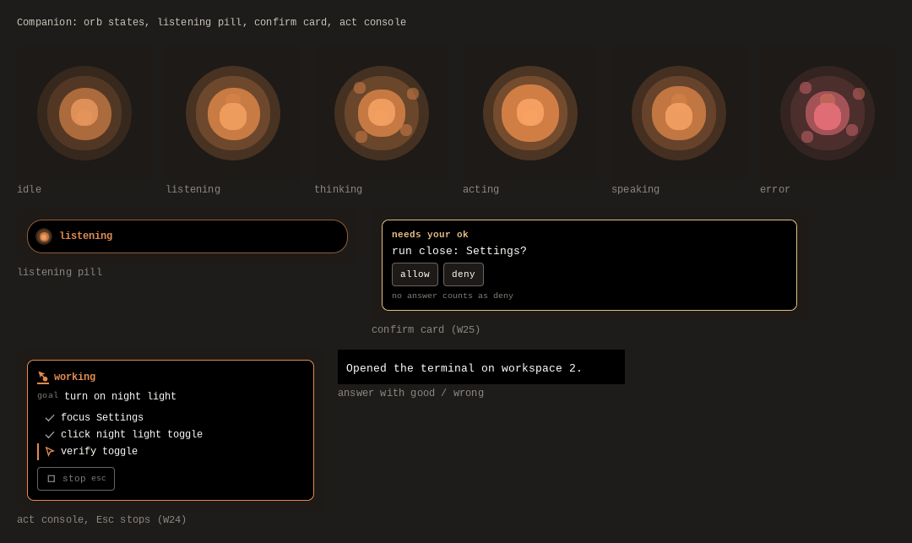

# Wisp

Wisp is a voice teacher and doer for Omarchy: hold the key, ask, and it
answers out loud and points at your screen. This repository is the Omarchy
plugin only (the bar mark, the live pill and the overlay), built from
[https://github.com/duketopceo/wisp](https://github.com/duketopceo/wisp), where the code, tests and issues live.



## Install

```sh
omarchy plugin add https://github.com/duketopceo/wisp-plugin.git --enable
```

The plugin shows the daemon's state. The daemon itself (`wispd`) comes from
the source repository (the `--from-plugin` flag is newer than the last
packaged release); nothing is installed or edited until you say yes:

```sh
git clone https://github.com/duketopceo/wisp && cd wisp
python3 wispd install --from-plugin --dry-run   # every file, and the bind line
python3 wispd install --from-plugin             # prints the same, then asks
```

`--from-plugin` leaves this plugin folder to `omarchy plugin update`, and it
adds the push-to-talk bind to `~/.config/hypr/bindings.lua` only after your
yes.

## Remove

```sh
omarchy plugin remove io.github.duketopceo.wisp
systemctl --user disable --now wispd.service
rm -rf ~/.local/opt/wisp ~/.local/bin/wispd ~/.local/bin/wisp-trigger \
       ~/.local/share/applications/wisp.desktop
```

Your settings and memory stay in `~/.config/wisp` and
`~/.local/share/wisp`; delete those for a full wipe. Remove the
`-- Wisp push-to-talk` lines from `~/.config/hypr/bindings.lua`.

## License

AGPL-3.0-only, see LICENSE (releases up to v0.9.0 were MIT). Bundled
third-party notices are in THIRD_PARTY_NOTICES.md. Version 0.9.1.
